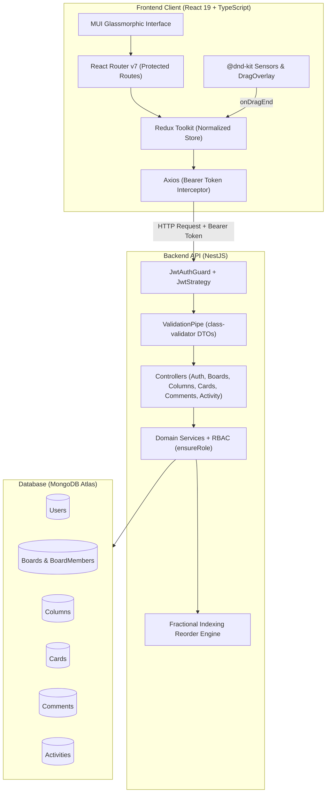
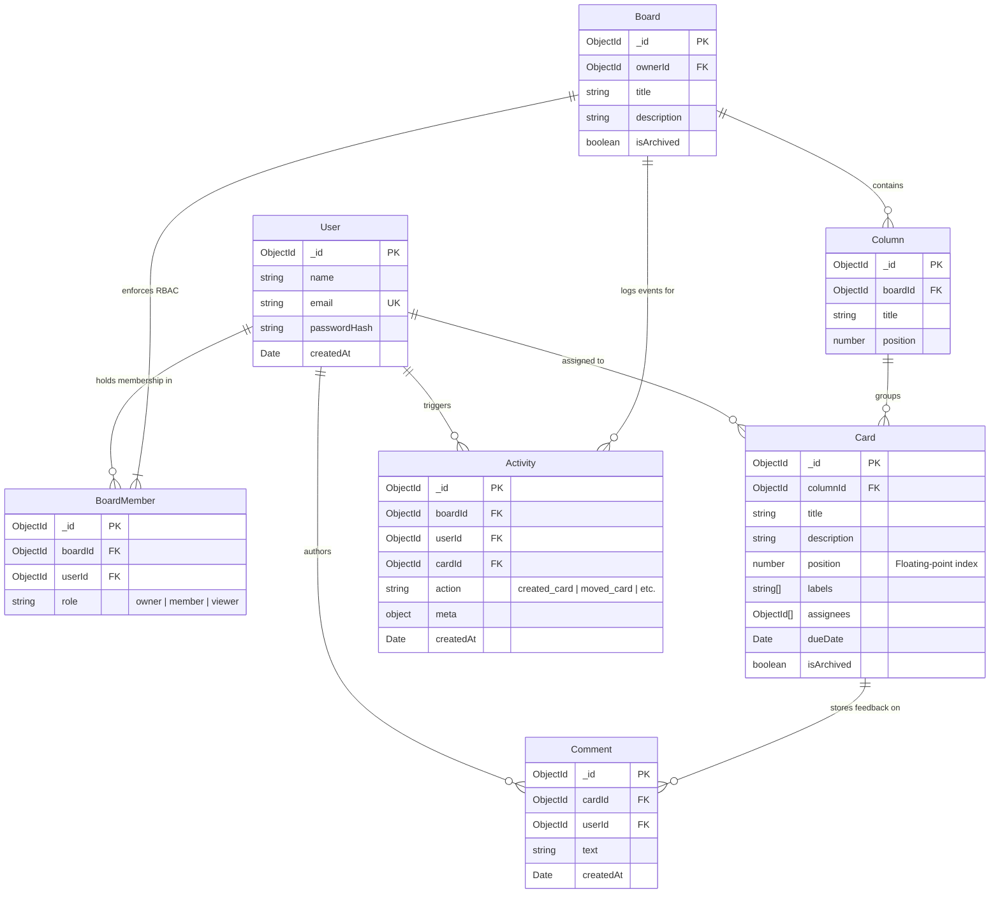

# ⬡ Kanban — Collaborative Project Management System

[](https://react.dev/)
[](https://www.typescriptlang.org/)
[](https://nestjs.com/)
[](https://www.mongodb.com/)
[](https://redux-toolkit.js.org/)
[](https://vitejs.dev/)
[](https://mui.com/)
[](LICENSE)

A full-stack, enterprise-grade collaborative Kanban board application inspired by Trello. Designed for cross-functional teams to plan, organize, and execute workflows visually with zero-latency drag-and-drop, strict role-based authorization, card discussions, and an automated audit trail.

---

## 📌 Table of Contents

- [Key Features](#-key-features)
- [Architecture & Tech Stack](#-architecture--tech-stack)
- [System Architecture & Flow](#-system-architecture--flow)
- [Database Models & Relationships](#-database-models--relationships)
- [Core Engineering Highlights](#-core-engineering-highlights)
  - [1. Fractional Midpoint Indexing ($O(1)$ Reordering)](#1-fractional-midpoint-indexing-o1-reordering)
  - [2. Zero-Latency Optimistic UI Updates](#2-zero-latency-optimistic-ui-updates)
  - [3. Two-Tier Role-Based Access Control (RBAC)](#3-two-tier-role-based-access-control-rbac)
  - [4. Normalized Redux State Architecture](#4-normalized-redux-state-architecture)
- [API Reference](#-api-reference)
- [Project Directory Structure](#-project-directory-structure)
- [Getting Started](#-getting-started)
  - [Prerequisites](#prerequisites)
  - [Backend Setup](#backend-setup)
  - [Frontend Setup](#frontend-setup)
- [License](#-license)

---

## 🚀 Key Features

- **Visual Kanban Canvas**: Create multiple custom boards with flexible, reorderable columns (lists) and cards.
- **Fluid Drag-and-Drop (DnD)**: Seamless card movement between and within columns powered by `@dnd-kit` with touch/pointer sensors, collision detection, and drag overlays.
- **Optimistic UI Engine**: Zero perceived latency on card moves—state updates instantly in the client and syncs to MongoDB asynchronously.
- **Team Collaboration & Multi-Tenancy**: Invite colleagues by email with granular roles (**Owner**, **Member**, **Viewer**).
- **Task Management Drawer**: Dedicated card detail view with due dates, multi-colored priority tags (`bug`, `feature`, `design`, `urgent`, `high`, `medium`, `low`), and formatted descriptions.
- **Live Discussion Threads**: Nested comment feed on every task with author timestamps and delete permissions.
- **Real-Time Audit Feed**: Automated event tracking capturing card creations, edits, movements, and deletions over a 50-action board timeline.
- **Modern Glassmorphic Design System**: Custom Material-UI theme featuring frosted-glass headers, ambient SaaS gradients, and responsive scroll surfaces.

---

## 🛠 Architecture & Tech Stack

```
kanban-app/
├── backend/    # NestJS REST API + Mongoose ODM + Passport JWT
└── frontend/   # React 19 SPA + Redux Toolkit + @dnd-kit + MUI
```

### Frontend
- **Framework**: React 19 (TypeScript) bundled with **Vite**
- **State Management**: **Redux Toolkit (RTK)** with `createSlice` and `createAsyncThunk`
- **Drag & Drop**: `@dnd-kit/core`, `@dnd-kit/sortable`, `@dnd-kit/utilities`
- **Styling & UI**: Material UI (MUI v9), Emotion, custom glassmorphism theme
- **Routing**: React Router v7 with protected route wrappers (`PrivateRoute`)
- **HTTP Client**: Axios with interceptors for automatic Bearer JWT injection

### Backend
- **Framework**: **NestJS v12** (TypeScript, modular dependency injection)
- **Database**: **MongoDB Atlas** managed via **Mongoose v9**
- **Authentication**: Stateless JSON Web Tokens (**JWT**), **Passport.js** (`passport-jwt`), **bcrypt**
- **Validation**: Global `ValidationPipe` with strict DTO typing via `class-validator` and `class-transformer`

---

## 🔄 System Architecture & Flow



---

## 🗄 Database Models & Relationships



---

## 💡 Core Engineering Highlights

### 1. Fractional Midpoint Indexing ($O(1)$ Reordering)
Traditional Kanban applications re-index every card in a column when an item is moved:
$$\text{Cost: } O(N) \text{ database update operations}$$

In this system, cards use floating-point position coordinates. When a card is inserted between Card $A$ and Card $B$:
$$\text{newPosition} = \frac{\text{position}_A + \text{position}_B}{2}$$

- **Edge Cases Handled**:
  - Insert at beginning: `cards[0].position / 2`
  - Insert at end: `lastCard.position + 1`
  - Empty column: `0`
- **Result**: Exactly **one document write** in MongoDB regardless of whether a column has 10 cards or 10,000 cards.

### 2. Zero-Latency Optimistic UI Updates
When a user releases a dragged card:
1. `onDragEnd` synchronously dispatches `optimisticMoveCard` to the Redux store.
2. The card is instantly spliced out of the source column and placed into the target column in local state (0ms latency).
3. `moveCard.thunk` sends the `PATCH /cards/:id/move` request to the server in the background.
4. When the server responds, it syncs the normalized floating-point position back to Redux without UI flashing.

### 3. Two-Tier Role-Based Access Control (RBAC)
Security is enforced using a defense-in-depth model:
- **Client Tier**: `usePermissions(myRole)` conditionally disables drag handles, edit drawers, invite modals, and comment buttons.
- **Server Tier**: `BoardsService.ensureRole(boardId, userId, [allowedRoles])` validates membership and role permissions directly against the database on every mutating endpoint.

| Capability | Owner | Member | Viewer |
| :--- | :---: | :---: | :---: |
| View Board, Columns, Cards & Feed | ✅ | ✅ | ✅ |
| Drag & Drop Cards | ✅ | ✅ | ❌ |
| Create / Edit / Delete Cards | ✅ | ✅ | ❌ |
| Manage Lists / Columns | ✅ | ✅ | ❌ |
| Post & Delete Comments | ✅ | ✅ | ❌ |
| Invite / Manage Board Members | ✅ | ❌ | ❌ |
| Edit Board Metadata or Delete Board | ✅ | ❌ | ❌ |

### 4. Normalized Redux State Architecture
Rather than storing a deep, nested board object in Redux, card data is partitioned:
```typescript
interface CardsState {
  cardsByColumn: Record<string, Card[]>; // Key: columnId, Value: Card[]
  loading: boolean;
  error: string | null;
}
```
This isolates column re-renders so that updating or dragging a card in "In Progress" never triggers re-rendering of cards in "To Do" or "Done".

---

## 📡 API Reference

All protected endpoints require an `Authorization: Bearer <token>` header.

### Authentication (`/auth`)
| Method | Endpoint | Description | Access |
| :--- | :--- | :--- | :--- |
| `POST` | `/auth/signup` | Register a new account | Public |
| `POST` | `/auth/login` | Authenticate and obtain JWT | Public |
| `GET` | `/auth/me` | Fetch authenticated user profile | Private |

### Boards (`/boards`)
| Method | Endpoint | Description | Access |
| :--- | :--- | :--- | :--- |
| `POST` | `/boards` | Create a new board (creator becomes Owner) | Private |
| `GET` | `/boards` | Retrieve all boards the user belongs to | Private |
| `GET` | `/boards/:id` | Get board details and current user's role | Member / Viewer |
| `PATCH` | `/boards/:id` | Update board title / description | Owner Only |
| `DELETE` | `/boards/:id` | Delete board and all memberships | Owner Only |
| `POST` | `/boards/:id/members` | Invite a teammate with Member or Viewer role | Owner Only |

### Columns (`/boards/:boardId/columns` & `/columns`)
| Method | Endpoint | Description | Access |
| :--- | :--- | :--- | :--- |
| `POST` | `/boards/:boardId/columns` | Create a new column in a board | Owner / Member |
| `GET` | `/boards/:boardId/columns` | Get all columns for a board (sorted) | Member / Viewer |
| `PATCH` | `/columns/:id` | Rename column or update position | Owner / Member |
| `DELETE` | `/columns/:id` | Delete column and associated cards | Owner / Member |

### Cards (`/columns/:columnId/cards` & `/cards`)
| Method | Endpoint | Description | Access |
| :--- | :--- | :--- | :--- |
| `POST` | `/columns/:columnId/cards` | Create a new card in a column | Owner / Member |
| `GET` | `/columns/:columnId/cards` | Get all cards in a column (sorted by position) | Member / Viewer |
| `PATCH` | `/cards/:id` | Update card title, description, due date, labels | Owner / Member |
| `PATCH` | `/cards/:id/move` | Move card across columns or reorder ($O(1)$) | Owner / Member |
| `DELETE` | `/cards/:id` | Remove card and log deletion | Owner / Member |

### Comments & Activity Feed
| Method | Endpoint | Description | Access |
| :--- | :--- | :--- | :--- |
| `POST` | `/cards/:cardId/comments` | Post a new comment on a card | Owner / Member |
| `GET` | `/cards/:cardId/comments` | Retrieve comment thread for a card | Member / Viewer |
| `DELETE` | `/comments/:id` | Delete comment (author only) | Author |
| `GET` | `/boards/:boardId/activity` | Get last 50 audit actions on board | Member / Viewer |
| `GET` | `/cards/:cardId/activity` | Get audit actions for a specific card | Member / Viewer |

---

## 📂 Project Directory Structure

```
kanban-app-new/
├── backend/
│   ├── src/
│   │   ├── activity/          # Activity logging service & schema
│   │   ├── auth/              # JWT strategy, guards, auth controller & service
│   │   ├── boards/            # Board & BoardMember schemas, service, controller
│   │   ├── cards/             # Card schema, fractional move logic, controller
│   │   ├── columns/           # Column schema, reordering service, controller
│   │   ├── comments/          # Card commenting service, schema, controller
│   │   ├── users/             # User account schema & service
│   │   ├── app.module.ts      # Root NestJS dependency module
│   │   └── main.ts            # NestJS entry point & validation pipe configuration
│   ├── .env                   # Environment variables
│   ├── package.json
│   └── tsconfig.json
│
├── frontend/
│   ├── src/
│   │   ├── api/               # Axios instance & Bearer auth interceptors
│   │   ├── app/               # Redux store configuration
│   │   ├── components/        # Reusable UI components
│   │   │   ├── ActivityFeed.tsx        # Timeline drawer for board events
│   │   │   ├── AddCardForm.tsx         # Inline card creation
│   │   │   ├── AddColumnForm.tsx       # Inline column creation
│   │   │   ├── CardDetailDrawer.tsx    # Card editor, labels, comments
│   │   │   ├── ColumnHeader.tsx        # List title and menu actions
│   │   │   ├── DroppableColumn.tsx     # DnD-Kit droppable container
│   │   │   ├── InviteMemberDialog.tsx  # Team invitation modal
│   │   │   └── KanbanCard.tsx          # Draggable card item with label badges
│   │   ├── features/          # Redux slices (auth, boards, columns, cards)
│   │   ├── hooks/             # Typed hooks (useAppDispatch, usePermissions)
│   │   ├── pages/             # Route views (LoginPage, SignupPage, BoardsPage, BoardDetailPage)
│   │   ├── types/             # TypeScript domain interfaces
│   │   ├── App.tsx            # Route setup & private route gatekeeper
│   │   ├── index.css          # Baseline styling & custom scrollbars
│   │   ├── main.tsx           # React root provider
│   │   └── theme.ts           # MUI component overrides & glassmorphic styles
│   ├── package.json
│   ├── tsconfig.json
│   └── vite.config.ts
│
└── README.md
```

---

## 💻 Getting Started

### Prerequisites
- [Node.js](https://nodejs.org/) (v18 or higher)
- [npm](https://www.npmjs.com/) or [yarn](https://yarnpkg.com/)
- A running [MongoDB](https://www.mongodb.com/) instance (local or MongoDB Atlas connection string)

---

### Backend Setup

1. Navigate to the backend directory:
   ```bash
   cd backend
   ```

2. Install dependencies:
   ```bash
   npm install
   ```

3. Configure environment variables:
   Create a `.env` file in the `backend/` folder:
   ```env
   PORT=3000
   MONGODB_URI=mongodb+srv://<username>:<password>@cluster.mongodb.net/kanban
   JWT_SECRET=your_jwt_secret_key_here
   JWT_EXPIRES_IN=7d
   ```

4. Run the backend server:
   ```bash
   # Development watch mode
   npm run start:dev

   # Production build
   npm run build
   npm run start:prod
   ```
   The backend server runs at `http://localhost:3000`.

---

### Frontend Setup

1. Navigate to the frontend directory:
   ```bash
   cd ../frontend
   ```

2. Install dependencies:
   ```bash
   npm install
   ```

3. Start the Vite development server:
   ```bash
   npm run dev
   ```
   The frontend runs at `http://localhost:5173`.

4. Build for production:
   ```bash
   npm run build
   npm run preview
   ```

---

## 📜 License

This project is licensed under the [MIT License](LICENSE).
